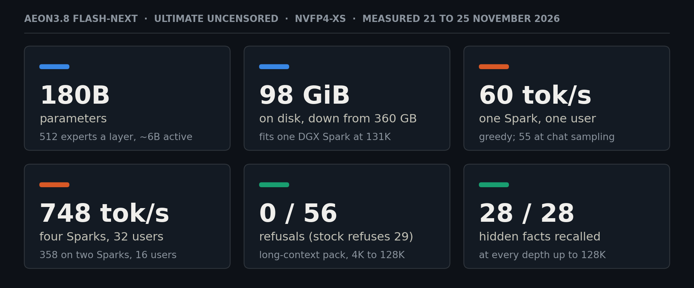
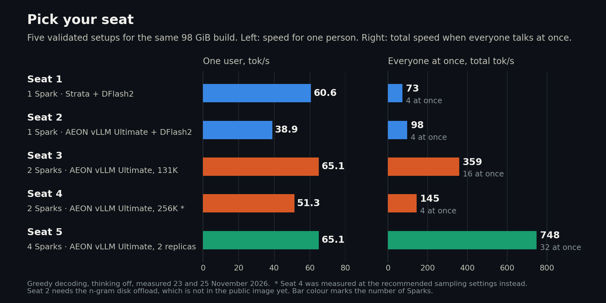
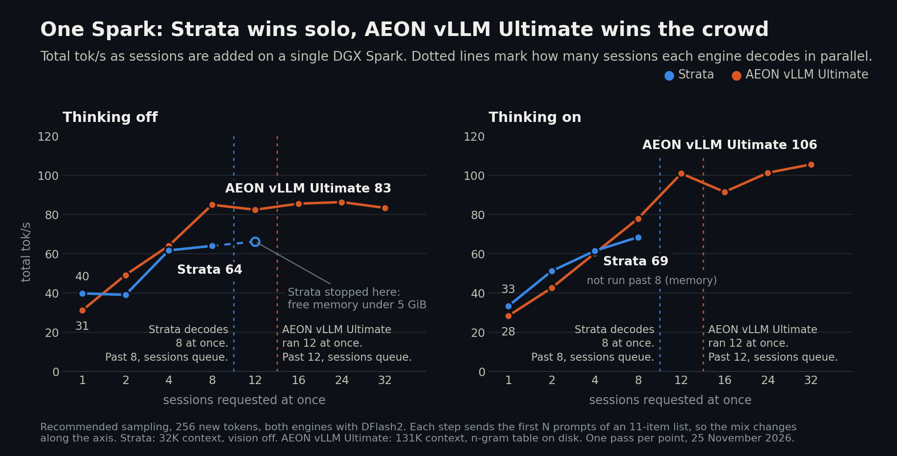

# Aeon3.8-Flash-Next Ultimate Uncensored: quick-start index

 

**A 180-billion-parameter model with the refusals removed, running on one desktop DGX Spark at 60 tokens a second.**

This repo is the index of serve recipes for [Aeon3.8-Flash-Next-ULTIMATE-UNCENSORED-NVFP4-XS](https://huggingface.co/AEON-7/Aeon3.8-Flash-Next-ULTIMATE-UNCENSORED-NVFP4-XS), the 98 GiB build of Qwen3.8-Flash-Next with its refusals removed. Each guide names its target hardware, gives the numbers we measured on it, and ends in commands you can paste. If an AI agent is doing the setup, give it [`AGENTS.md`](AGENTS.md).

| What | Where |
|---|---|
| The weights, every measurement, charts, limits | [Hugging Face: NVFP4-XS](https://huggingface.co/AEON-7/Aeon3.8-Flash-Next-ULTIMATE-UNCENSORED-NVFP4-XS) |
| The 360 GB master, and how the uncensoring was done and tested | [Hugging Face: BF16](https://huggingface.co/AEON-7/Aeon3.8-Flash-Next-Ultimate-Uncensored-BF16) |
| The engine behind Seats 2 to 5 | [AEON vLLM Ultimate](https://github.com/AEON-7/vllm-ultimate-dgx-spark) |
| The engine behind Seat 1 | [Strata](https://github.com/Niko1221/Strata) |
| Instructions written for AI agents | [`AGENTS.md`](AGENTS.md), also in the Hugging Face repo |

## Pick your seat

| Seat | Hardware | Engine | Context | One user | Many users | Guide |
|---|---|---|---|---|---|---|
| **1** | 1 DGX Spark | Strata + DFlash2 | 131K, images | **60.6 tok/s** | 73 across 4 | [Strata on one Spark](quickstart/seat-1-strata-one-spark.md) |
| **2** | 1 DGX Spark | AEON vLLM Ultimate + DFlash2, n-gram table on disk | 131K, images | 38.9 tok/s | **97.5** across 4 | [AEON vLLM Ultimate on one Spark](quickstart/seat-2-aeon-vllm-ultimate-one-spark.md) |
| **3** | 2 DGX Sparks, linked | AEON vLLM Ultimate + DFlash2, tensor-parallel | 131K, images | 58 to 65 tok/s | **359** across 16 | [Two Sparks, team server](quickstart/seat-3-two-sparks-team-server.md) |
| **4** | 2 DGX Sparks, linked | AEON vLLM Ultimate, tensor-parallel | **256K**, images | 51 tok/s | 145 across 4 | [Two Sparks, long thinking](quickstart/seat-4-two-sparks-long-thinking.md) |
| **5** | 4 DGX Sparks | AEON vLLM Ultimate, two replicas and a balancer | 131K, images | 58 to 65 tok/s | **748** across 32 | [Four Sparks](quickstart/seat-5-four-sparks.md) |

Speeds are greedy decoding with thinking off, except Seat 4, which was measured at the [recommended sampling](quickstart/sampling.md). Each guide lists its own numbers at those settings and with thinking on. Everything was measured on our own Sparks between 21 and 25 November 2026.

**Three rules of thumb.**

- **For one stream, Strata. For many, AEON vLLM Ultimate.** On one Spark, Strata is 56% faster for a single user (60.6 against 38.9 tok/s). But it tapers as sessions are added: its total rises from 61 to 73 tok/s at four streams and stays there, and it never decodes more than 8 streams in parallel. AEON vLLM Ultimate goes the other way, from 39 to 98 tok/s at four streams on the same box, then to 359 on two Sparks and 748 on four.
- **A second Spark buys concurrency, not single-user speed.** One user gets about 60 tok/s on one Spark and 58 to 65 on two.
- **Use the [sampling settings](quickstart/sampling.md) on every seat.** Long reasoning at temperature 0 can loop.

## For AI agents

[`AGENTS.md`](AGENTS.md) is written for an agent that has been asked to bring the model up. It tells the agent how to identify the hardware, which seat that hardware maps to, the exact serve configuration for each one, which values depend on the site and which must not be touched, what numbers to expect, and what to report. The commands in it are the same ones as in the guides, copied from the runs we measured.

The same file is in the Hugging Face repo, at [`AGENTS.md`](https://huggingface.co/AEON-7/Aeon3.8-Flash-Next-ULTIMATE-UNCENSORED-NVFP4-XS/blob/main/AGENTS.md), so an agent that only has the weights still has the instructions.

## Status

- **Seats 1 to 5 run on public software as written.** Seat 2 uses `ghcr.io/aeon-7/aeon-vllm-ultimate:2026-11-25-v0.33.0-omni-dflash2-ngram-disk` (digest `sha256:4749bd067524ce41a4a6d59625f6b6c8531d08a14739bd0d416e935b9fc3a1ad`). Seats 3 to 5 stay on `2026-11-23-v0.33.0-omni-dflash2`.
- **Not measured:** a single job at tensor-parallel size 4. Any hardware other than DGX Spark. A homogeneous 4-Spark pair of identical DFlash2 replicas (Seat 5 was measured with one DFlash2 replica and one MTP replica). Seat 3's default is now DFlash2 k=3 at 32 sequences, measured at the published sampling (see that guide).

## Responsibility and license

This is an **uncensored** model. Its refusal behaviour has been removed, and it makes no judgement about whether to comply. You are the safety layer. The full [User Responsibility & Arbitration Clause](https://huggingface.co/AEON-7/Aeon3.8-Flash-Next-ULTIMATE-UNCENSORED-NVFP4-XS#user-responsibility--arbitration-clause) on the model card applies to every use of it.

The weights are under the Qwen Community License 1.0. The recipes and instructions in this repo are documentation for them.

## Support the work

AEON-7 models, engines and tools are built independently, on my own hardware. If they are useful to you:

 

**[AEON FORGE on LotusMake](https://lotusmake.com/c/aeon-forge)**
