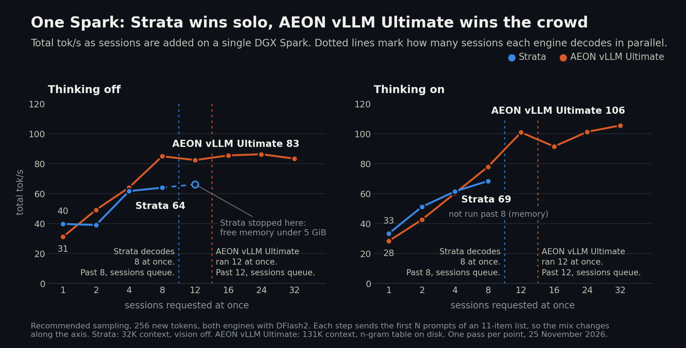

# Seat 2: AEON vLLM Ultimate on one Spark

[Quick-start index](../README.md) · [Sampling settings](sampling.md) · [AGENTS.md](../AGENTS.md) · [Model card and all measurements](https://huggingface.co/AEON-7/Aeon3.8-Flash-Next-ULTIMATE-UNCENSORED-NVFP4-XS)

> **Hardware** 1 DGX Spark, 128 GB, NVMe · **Download** 108 GB (`vllm/`) plus the DFlash2 drafter · **Context** 131K · **Images** on · **Engine** AEON vLLM Ultimate with the n-gram table on disk

> **Status: validated, not yet reproducible from the public image.** The stock image keeps the 28.8 GB n-gram table in pinned host RAM. On a Spark that RAM is the same 121 GiB pool as the weights, so the stock image does not fit on one box. We measured this seat with a file-backed offload: the table lives on NVMe and is mapped into memory, the kernel's page cache keeps the hot part in RAM, and a manifest lets later boots reuse it. Today that offload is a patch mounted onto the image. A tagged image that includes it is coming, and this card will carry the tag when it ships. **Until then, do not run these commands on one Spark. It will not fit.**

| 4-sequence serve, measured 25 November 2026 | one user | four at once (total) |
|---|---|---|
| Greedy, thinking off | 38.9 tok/s | **97.5 tok/s** |
| Recommended sampling, thinking off | 36.2 | 79.3 |
| Recommended sampling, thinking on | 30.3 | 70.7 |

Four people get 24 tok/s each, a third more in total than Strata manages on the same box. One user is slower here than on Strata: about a tenth of every decoding step is the n-gram lookup coming back from disk, and Strata's expert kernels are leaner besides.

Raise the cap to 32 sequences and the same box admits 32 sessions and runs twelve of them at a time. With twelve generating together it delivered 83 tok/s in total at the recommended sampling, 101 with thinking on and 97 greedy, each session decoding at 8 to 10 tok/s. Sessions past the twelfth wait their turn.

Image: `ghcr.io/aeon-7/aeon-vllm-ultimate:2026-11-23-v0.33.0-omni-dflash2` (digest `sha256:71c2b82b3b0c97ddca9ef35b279fb745ee0abe29b762a24c8c0771cf930f11ab`). This is [AEON vLLM Ultimate](https://github.com/AEON-7/vllm-ultimate-dgx-spark): vLLM 0.33.0 built for the GB10, plus our hook that lets DFlash2 run on Flash-Next.

**1. Download** the vLLM weights and the DFlash2 drafter:

```sh
hf download AEON-7/Aeon3.8-Flash-Next-ULTIMATE-UNCENSORED-NVFP4-XS --include 'vllm/*' --local-dir /models/aeon-xs
huggingface-cli download incoai/Qwen3.8-Flash-Next-DFlash2 --local-dir /models/dflash2
```

**2a. Low latency: 4 sequences, 131K.** These are the flags behind the table. Leave `--gpu-memory-utilization` at 0.74. Raising it to buy KV cache takes memory away from the page cache that holds the n-gram table.

```sh
IMG=ghcr.io/aeon-7/aeon-vllm-ultimate:2026-11-23-v0.33.0-omni-dflash2
MODEL=/models/aeon-xs/vllm
DRAFT=/models/dflash2

docker run -d --name aeon-xs --ipc host --shm-size 16g --gpus all \
  -v $MODEL:/model:ro -v $DRAFT:/draft:ro \
  --entrypoint vllm $IMG serve /model --trust-remote-code --served-model-name aeon-xs \
  --host 0.0.0.0 --port 8000 \
  --engram-config '{"cpu_offload":true}' \
  --limit-mm-per-prompt '{"image":2,"video":0}' \
  --reasoning-parser qwen3 --tool-call-parser qwen3_coder --enable-auto-tool-choice \
  --enable-prefix-caching \
  --max-model-len 131072 --max-num-seqs 4 --gpu-memory-utilization 0.74 \
  --max-num-batched-tokens 16384 \
  --speculative-config '{"method":"dflash","model":"/draft","num_speculative_tokens":3}' \
  --override-generation-config '{"temperature":0.6,"top_p":0.95,"top_k":20,"presence_penalty":0.5,"repetition_penalty":1.0}'
```

**2b. More sessions: 32 sequences, 131K.** Same image, same weights, same utilization. Only `--max-num-seqs` changes.

```sh
# same docker flags as the low-latency recipe, except:
  --max-model-len 131072 --max-num-seqs 32 --gpu-memory-utilization 0.74
```

- **Draft tokens: use 3.** 8 stops the engine at startup. 11 starts, and with the MTP head ran about 30% slower (see [Field notes](https://huggingface.co/AEON-7/Aeon3.8-Flash-Next-ULTIMATE-UNCENSORED-NVFP4-XS#field-notes)).
- **The KV cache is one shared pool** of about 10 GiB on the 4-sequence serve. That is room for a couple of full 131K contexts or for many short ones, not for many long ones.
- **The first minutes after boot are slow.** The table's pages are still coming off disk, and our first pass after a boot ran at about half speed. Send a few warm-up requests before you measure anything.
- **Twelve at a time.** In our runs the serve never generated for more than 12 sessions at once, whatever the cap. With 16, 24 or 32 requested, exactly 12 got a first token within two seconds and the rest queued, for up to 75 s at 32. Total throughput is flat from 12 sessions up. We have not found what holds it at 12.

**One Spark, both engines, session by session.** Same sampling, 256 new tokens, both engines with their cap raised to 32. Each step sends the first N prompts of an 11-item list, so the mix of work changes as the ladder climbs, and the one-session point is a single chat prompt. Compare the two engines at each step. Do not compare a step with the 11-workload figures above.

Both engines have a limit on how many sessions they decode in parallel, and the dotted lines on the chart mark it. Strata has a hard cap of 8. AEON vLLM Ultimate ran 12. Past those points a new session is not worked on alongside the others. It waits in a queue, which is why each line levels off.



<details>
<summary><b>Full ladder: total tok/s / decode rate of one running session</b></summary>

Recommended sampling, thinking off:

| sessions requested | Strata + DFlash2 | AEON vLLM Ultimate + DFlash2 |
|---|---|---|
| 1 | 39.9 / 39.7 | 31.2 / 31.1 |
| 2 | 39.1 / 21.2 | 49.3 / 26.1 |
| 4 | 61.8 / 16.8 | 64.2 / 19.2 |
| 8 | 64.1 / 9.6 | 85.0 / 12.2 |
| 12 | 66.3 / 6.2 (8 decoding, 4 queued; 4.43 GiB free, under the 5 GiB floor) | 82.5 / 8.5 |
| 16 | stopped at 3.74 GiB free | 85.6 / 9.9 (12 running, 4 queued) |
| 24 | not run | 86.4 / 8.5 (12 running, 12 queued) |
| 32 | not run | 83.5 / 8.4 (12 running, 20 queued) |

Recommended sampling, thinking on:

| sessions requested | Strata + DFlash2 | AEON vLLM Ultimate + DFlash2 |
|---|---|---|
| 1 | 33.4 / 33.3 | 28.4 / 28.3 |
| 2 | 51.2 / 26.9 | 42.7 / 21.5 |
| 4 | 61.6 / 16.4 | 60.3 / 15.7 |
| 8 | 68.5 / 9.2 | 78.0 / 10.3 |
| 12 | not run | 101.0 / 9.3 |
| 16 | not run | 91.6 / 10.7 (12 running, 4 queued) |
| 24 | not run | 101.4 / 9.1 (12 running, 12 queued) |
| 32 | not run | 105.6 / 10.2 (12 running, 20 queued) |

Strata ran the 32K, vision-off experiment described under Seat 1. AEON vLLM Ultimate ran the 32-sequence, 131K recipe after a warm start. Each step is one pass. The second number is how fast a session decodes once it is running, not the total divided by the session count.

- **Waiting.** With up to 12 requested, every session gets its first token in under a second. At 16 requested, the four that queue wait up to 29 s. At 32 requested, the median wait is 24 to 39 s and the longest is 58 to 75 s.
- **Loop flags that are not loops.** With thinking off, our loop detector flagged 1, 1, 2 and 3 answers at 12, 16, 24 and 32 sessions. That is exactly how many copies each step contains of one prompt in the list, which asks the model to repeat a sentence 40 times. The ladder did not save the text, so we could not read those answers, but we do not count them as loops. Thinking on showed none.

</details>

---

Measurements, methods, charts and limits are on the [model card](https://huggingface.co/AEON-7/Aeon3.8-Flash-Next-ULTIMATE-UNCENSORED-NVFP4-XS). Back to the [quick-start index](../README.md).
